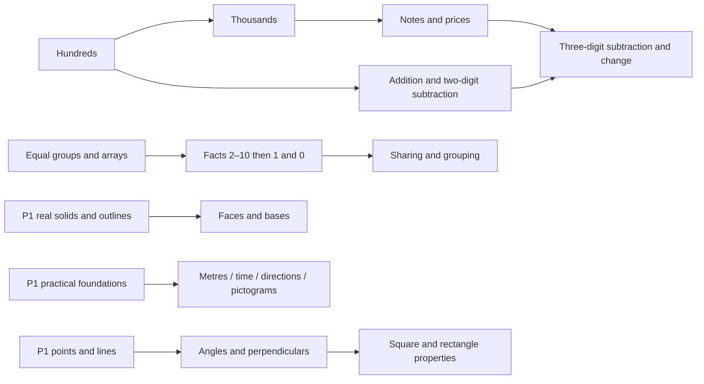

# Whole-P2 coverage, sequence and readiness review

22 November 2026. Reviewed published baseline `b5d8f51cb1b234d21350eb962063bb5e8622c7a1`.

## Decision

**The guided teaching/resources address all 59 numbered P2 objectives plus integrated inquiry. P2 is not yet validated as an independent readiness assessment.** Keep the existing branch sequence; do not start guided P3 implementation yet. The next product step is a separate P2 application/readiness review with fresh situations, explicit practical observations and targeted revisits.

The inventory is **16 topics, 90 bilingual lessons, 810 practice items, 180 guided items, 178 topic-check items and 16 investigation opportunities**. These counts refer to authored items, not unique problem structures or demonstrated pupil attainment. Fourteen numbered-objective units become sixteen topics because multiplication and time each span two topics. Inquiry is integrated, not an extra scored topic.

This release changes documentation and adds a reproducible source-audit script only. Lesson payloads, IDs, quiz answers, storage and pupil routes remain unchanged. Earlier historical statements of “resource complete” are not evidence that pupils have performed the practical work.

## Evidence and method

Checked the current [EDB supplement](https://www.edb.gov.hk/attachment/en/curriculum-development/kla/ma/curr/pmc2017_e.pdf) and [KS1 explanatory notes](https://www.edb.gov.hk/attachment/en/curriculum-development/kla/ma/curr/en_ks1_e.pdf), particularly printed pages 19–42 in the notes (PDF pages 25–48). The notes explicitly permit logical teaching sequences rather than prescribing the printed order. Their number→money→change connection and practical requirements inform this review; the product design decisions below are MathQuiz judgements.

Reviewed the sixteen data modules, all ninety lesson explanations, their practical prompts, the shared map/check renderer, the inquiry data and linked unit briefs. The ledger records primary teaching locations; it does not rely only on objective metadata (three topic modules do not have per-lesson objective arrays). The [machine-readable audit](p2-coverage-evidence.json) gives exact lesson IDs, source hashes and repeat-item pairs. Run [the source audit](../tests/p2-coverage-audit.cjs) with Node to regenerate it.

## Objective ledger

Every row means **teaching/practical opportunity located**, not “pupil passed”. Links open the lesson that supplies the teaching; oral, physical and independent evidence requirements are below. Objective labels are short audit descriptions; consult EDB and the linked unit briefs for full wording and remarks.

| Objective | Audited focus | Teaching locations |
| --- | --- | --- |
| 2N1.1 | Three-digit recognition | [Build a hundred](../p2-learn.html?path=numbers&lesson=p2-hundred&stage=learn); [Read, count and notice](../p2-learn.html?path=numbers&lesson=p2-sequence&stage=learn) |
| 2N1.2 | Hundreds place | [Build a hundred](../p2-learn.html?path=numbers&lesson=p2-hundred&stage=learn) |
| 2N1.3 | Magnitude | [Compare and order](../p2-learn.html?path=numbers&lesson=p2-compare&stage=learn) |
| 2N1.4 | Groups of 20/25/50/100 | [Count bigger groups](../p2-learn.html?path=numbers&lesson=p2-groups&stage=learn) |
| 2N1.5 | Quantity estimates | [Estimate then check](../p2-learn.html?path=numbers&lesson=p2-estimate&stage=learn) |
| 2N2.1 | Addition | [Add with exchanges](../p2-learn.html?path=arithmetic&lesson=p2-carry&stage=learn) |
| 2N2.2 | Useful addition grouping | [Choose helpful addition pairs](../p2-learn.html?path=arithmetic&lesson=p2-smartadd&stage=learn) |
| 2N2.3 | Subtraction | [Exchange a ten to subtract](../p2-learn.html?path=arithmetic&lesson=p2-borrow&stage=learn); [Subtract in the stated order](../p2-learn.html?path=arithmetic&lesson=p2-substeps&stage=learn) |
| 2N2.4 | Problems | [Choose a calculation and explain](../p2-learn.html?path=arithmetic&lesson=p2-stories&stage=learn); [Estimate and check results](../p2-learn.html?path=arithmetic&lesson=p2-roughcheck&stage=learn) |
| 2N3.1 | Multiplication meaning | [Look for equal groups](../p2-learn.html?path=multiply&lesson=p2-equalgroups&stage=learn); [From repeated addition to ×](../p2-learn.html?path=multiply&lesson=p2-repeated&stage=learn); [Turn rows and columns](../p2-learn.html?path=multiply&lesson=p2-arrays&stage=learn) |
| 2N3.2 | 0–10 table | [Build facts with 2, 5 and 10](../p2-learn.html?path=multiply&lesson=p2-firstfacts&stage=learn); [Build the 3 and 4 facts](../p2-learn.html?path=facts&lesson=p2-facts34&stage=learn); [Double to build 6 and 8 facts](../p2-learn.html?path=facts&lesson=p2-facts68&stage=learn); [Use nearby facts for 7 and 9](../p2-learn.html?path=facts&lesson=p2-facts79&stage=learn); [Build the 2–10 table in sessions](../p2-learn.html?path=facts&lesson=p2-facttable&stage=learn); [One group and one in each](../p2-learn.html?path=facts&lesson=p2-timesone&stage=learn); [Empty groups and no groups](../p2-learn.html?path=facts&lesson=p2-timeszero&stage=learn) |
| 2N3.3 | Basic products | [From repeated addition to ×](../p2-learn.html?path=multiply&lesson=p2-repeated&stage=learn); [Build facts with 2, 5 and 10](../p2-learn.html?path=multiply&lesson=p2-firstfacts&stage=learn); [Choose, explain and revisit facts](../p2-learn.html?path=facts&lesson=p2-factuse&stage=learn) |
| 2N3.4 | Swapped factors | [Turn rows and columns](../p2-learn.html?path=multiply&lesson=p2-arrays&stage=learn); [Build the 3 and 4 facts](../p2-learn.html?path=facts&lesson=p2-facts34&stage=learn) |
| 2N3.5 | Problems | [Explain equal-group stories](../p2-learn.html?path=multiply&lesson=p2-multstories&stage=learn); [Choose, explain and revisit facts](../p2-learn.html?path=facts&lesson=p2-factuse&stage=learn) |
| 2N4.1 | Four-digit recognition | [Ten hundreds make a thousand](../p2-learn.html?path=thousands&lesson=p2-thousand&stage=learn); [Read and write four-digit numbers](../p2-learn.html?path=thousands&lesson=p2-readfour&stage=learn); [Cross 1000 and notice odd or even](../p2-learn.html?path=thousands&lesson=p2-crossfour&stage=learn) |
| 2N4.2 | Thousands place | [Ten hundreds make a thousand](../p2-learn.html?path=thousands&lesson=p2-thousand&stage=learn) |
| 2N4.3 | Groups of 200/250/500/1000 | [Count in larger groups](../p2-learn.html?path=thousands&lesson=p2-largegroups&stage=learn) |
| 2N4.4 | Magnitude | [Compare and order four-digit numbers](../p2-learn.html?path=thousands&lesson=p2-comparefour&stage=learn) |
| 2N5.1 | Three-digit subtraction | [Exchange hundreds, tens and ones](../p2-learn.html?path=change&lesson=p2-subhundreds&stage=learn); [Exchange across a zero](../p2-learn.html?path=change&lesson=p2-subzeros&stage=learn) |
| 2N5.2 | Mixed three-number operations | [Work from left to right](../p2-learn.html?path=change&lesson=p2-mixedsteps&stage=learn) |
| 2N5.3 | Problems including money | [Explain two changes](../p2-learn.html?path=change&lesson=p2-eventstories&stage=learn); [Give change in dollars and cents](../p2-learn.html?path=change&lesson=p2-moneychange&stage=learn); [Estimate, calculate and compare](../p2-learn.html?path=change&lesson=p2-estimatechanges&stage=learn) |
| 2N6.1 | Sharing and grouping | [Share equally: how many in each?](../p2-learn.html?path=division&lesson=p2-share&stage=learn); [Make groups: how many groups?](../p2-learn.html?path=division&lesson=p2-group&stage=learn); [Name the quotient and remainder](../p2-learn.html?path=division&lesson=p2-remainders&stage=learn) |
| 2N6.2 | Basic division | [Name the quotient and remainder](../p2-learn.html?path=division&lesson=p2-remainders&stage=learn); [Divide with zero and one](../p2-learn.html?path=division&lesson=p2-divzeroone&stage=learn) |
| 2N6.3 | Inverse relation | [Use multiplication to check](../p2-learn.html?path=division&lesson=p2-divcheck&stage=learn) |
| 2N6.4 | Problems and leftovers | [What do the leftovers mean?](../p2-learn.html?path=division&lesson=p2-divstories&stage=learn) |
| 2M1.1 | Metre | [Build and recognise one metre](../p2-learn.html?path=metres&lesson=p2-onemetre&stage=learn) |
| 2M1.2 | Real measurement/comparison | [Choose tools and measure carefully](../p2-learn.html?path=metres&lesson=p2-measuretools&stage=learn); [Read and compare lengths and distances](../p2-learn.html?path=metres&lesson=p2-lengthdistance&stage=learn); [Estimate first, then measure](../p2-learn.html?path=metres&lesson=p2-metreestimate&stage=learn) |
| 2M1.3 | Unit records | [Record metres and centimetres](../p2-learn.html?path=metres&lesson=p2-metrescm&stage=learn); [Read and compare lengths and distances](../p2-learn.html?path=metres&lesson=p2-lengthdistance&stage=learn) |
| 2M1.4 | Personal-reference estimates | [Measure a personal reference](../p2-learn.html?path=metres&lesson=p2-bodyruler&stage=learn); [Estimate first, then measure](../p2-learn.html?path=metres&lesson=p2-metreestimate&stage=learn) |
| 2M2.1 | Minute reading | [Read every minute on a clock](../p2-learn.html?path=minutes&lesson=p2-readminutes&stage=learn); [Digital clocks, earlier and later](../p2-learn.html?path=minutes&lesson=p2-digitaltime&stage=learn) |
| 2M2.2 | Minute sense | [Experience a minute](../p2-learn.html?path=minutes&lesson=p2-oneminute&stage=learn) |
| 2M2.3 | Real intervals | [Measure and compare minutes](../p2-learn.html?path=minutes&lesson=p2-measureminutes&stage=learn) |
| 2M2.4 | Interval problems | [Find the finishing time](../p2-learn.html?path=minutes&lesson=p2-finishingtime&stage=learn); [Find how many minutes passed](../p2-learn.html?path=minutes&lesson=p2-elapsedminutes&stage=learn) |
| 2M2.5 | 24-hour day | [A whole day, morning and afternoon](../p2-learn.html?path=calendar&lesson=p2-dayparts&stage=learn); [Noon, midnight and the next day](../p2-learn.html?path=calendar&lesson=p2-dayboundary&stage=learn) |
| 2M2.6 | a.m./p.m. | [A whole day, morning and afternoon](../p2-learn.html?path=calendar&lesson=p2-dayparts&stage=learn) |
| 2M2.7 | Contextual periods | [A whole day, morning and afternoon](../p2-learn.html?path=calendar&lesson=p2-dayparts&stage=learn); [Noon, midnight and the next day](../p2-learn.html?path=calendar&lesson=p2-dayboundary&stage=learn) |
| 2M2.8 | Month lengths | [Read all twelve month lengths](../p2-learn.html?path=calendar&lesson=p2-monthlengths&stage=learn) |
| 2M2.9 | Common/leap year lengths | [Common years and leap years](../p2-learn.html?path=calendar&lesson=p2-commonleap&stage=learn) |
| 2M2.10 | Event dates/day counts | [Count the days of an event](../p2-learn.html?path=calendar&lesson=p2-eventdays&stage=learn); [Find the first or last date](../p2-learn.html?path=calendar&lesson=p2-eventdates&stage=learn) |
| 2M3.1 | Notes | [Meet Hong Kong notes](../p2-learn.html?path=money&lesson=p2-notes&stage=learn) |
| 2M3.2 | Larger prices | [Read higher prices](../p2-learn.html?path=money&lesson=p2-prices&stage=learn) |
| 2M3.3 | Counting/exchanges/payment | [Count notes and coins](../p2-learn.html?path=money&lesson=p2-countmoney&stage=learn); [Exchange $10, $20, $50 and $100 notes](../p2-learn.html?path=money&lesson=p2-smallexchange&stage=learn); [Larger exchanges and exact payment](../p2-learn.html?path=money&lesson=p2-largemoney&stage=learn) |
| 2S1.1 | Faces/surfaces | [Touch flat and curved surfaces](../p2-learn.html?path=faces&lesson=p2-surfaces&stage=learn); [Find a prism’s bases and lateral faces](../p2-learn.html?path=faces&lesson=p2-prismfaces&stage=learn); [Find a pyramid’s base and lateral faces](../p2-learn.html?path=faces&lesson=p2-pyramidfaces&stage=learn); [Turn, compare and explain](../p2-learn.html?path=faces&lesson=p2-turnsolids&stage=learn) |
| 2S1.2 | Prism/pyramid names | [Name solids from their bases](../p2-learn.html?path=faces&lesson=p2-basenames&stage=learn); [Turn, compare and explain](../p2-learn.html?path=faces&lesson=p2-turnsolids&stage=learn) |
| 2S2.1 | Openings | [An angle is an opening](../p2-learn.html?path=angles&lesson=p2-opening&stage=learn) |
| 2S2.2 | Angle comparison | [Compare openings, not side lengths](../p2-learn.html?path=angles&lesson=p2-compareangles&stage=learn) |
| 2S2.3 | Right angles/perpendiculars | [Check a right angle](../p2-learn.html?path=angles&lesson=p2-rightangles&stage=learn); [Make and draw perpendicular lines](../p2-learn.html?path=angles&lesson=p2-perpendicular&stage=learn) |
| 2S2.4 | Perpendicular construction | [Make and draw perpendicular lines](../p2-learn.html?path=angles&lesson=p2-perpendicular&stage=learn); [The shortest connection to a line](../p2-learn.html?path=angles&lesson=p2-linedistance&stage=learn) |
| 2S2.5 | Acute/obtuse | [Make acute, right and obtuse angles](../p2-learn.html?path=angles&lesson=p2-anglekinds&stage=learn) |
| 2S2.6 | Make/draw angles | [An angle is an opening](../p2-learn.html?path=angles&lesson=p2-opening&stage=learn); [Make acute, right and obtuse angles](../p2-learn.html?path=angles&lesson=p2-anglekinds&stage=learn) |
| 2S3.1 | Cardinal directions | [Four directions and their short forms](../p2-learn.html?path=directions&lesson=p2-cardinal&stage=learn); [Find north before reading a map](../p2-learn.html?path=directions&lesson=p2-northarrow&stage=learn); [Say where one object is from another](../p2-learn.html?path=directions&lesson=p2-relativecompass&stage=learn); [Turn, check and follow a direction](../p2-learn.html?path=directions&lesson=p2-turnwalk&stage=learn) |
| 2S3.2 | Real compass use | [Measure with a real compass](../p2-learn.html?path=directions&lesson=p2-realcompass&stage=learn); [Turn, check and follow a direction](../p2-learn.html?path=directions&lesson=p2-turnwalk&stage=learn) |
| 2S4.1 | Segments | [Line segments join two points](../p2-learn.html?path=quads&lesson=p2-segments&stage=learn) |
| 2S4.2 | Quadrilaterals | [Four sides: adjacent and opposite](../p2-learn.html?path=quads&lesson=p2-quadsides&stage=learn) |
| 2S4.3 | Square/rectangle properties | [Check square properties](../p2-learn.html?path=quads&lesson=p2-square&stage=learn); [Check rectangle properties](../p2-learn.html?path=quads&lesson=p2-rectangle&stage=learn); [Make, test and repair shapes](../p2-learn.html?path=quads&lesson=p2-makequads&stage=learn) |
| 2S4.4 | Make/draw shapes | [Draw with a ruler and set square](../p2-learn.html?path=quads&lesson=p2-drawquads&stage=learn); [Make, test and repair shapes](../p2-learn.html?path=quads&lesson=p2-makequads&stage=learn) |
| 2D1.1 | Chart organisation | [Organise a collection](../p2-learn.html?path=pictograms&lesson=p2-sortdata&stage=learn); [Title, categories and key](../p2-learn.html?path=pictograms&lesson=p2-chartparts&stage=learn) |
| 2D1.2 | Interpretation | [Read horizontal pictograms](../p2-learn.html?path=pictograms&lesson=p2-readrows&stage=learn); [Read vertical pictograms](../p2-learn.html?path=pictograms&lesson=p2-readcolumns&stage=learn) |
| 2D1.3 | Construction | [Build and check both forms](../p2-learn.html?path=pictograms&lesson=p2-buildcharts&stage=learn) |

**2F1:** [sixteen investigations](../p2-investigate.html?path=division) retain initial predictions/plans and later evidence separately. A record or self-reported attempt neither proves independent inquiry nor certifies the allocated teaching time. Actual trials, explanation, transfer and adult support must be observed.

## Sequence: retain the branches, improve the overview

The shape route remains a spiral: **P1 real solids → traced outlines → flat shapes; P2 faces/bases alongside angles → square/rectangle properties**. It is unnecessary to move all 2-D material ahead of 3-D material. The EDB notes for 2S1 explicitly allow familiar quadrilateral descriptions of prism lateral faces before the 2S4 property work. Keep selected bases marked when models turn; family identification without a supplied family name needs real-model observation.

Recommended routes, with no compulsory locks:

Metres benefits from hundreds and P1 ruler handling; minute clocks can use concrete fives counting without waiting for fluent tables. The day/calendar branch can revisit P1 calendars while clock work develops. Inquiry belongs inside these routes. Revisit selected facts over several sessions rather than completing a table drill in one sitting.

The live map already groups three branches and supplies the important money, division and angle prerequisite links. Its compact topic chooser still lists topics in development order, and the number branch is mostly prose while other branches have direct links. That is a navigation improvement, not a missing curriculum unit. In the next readiness release, make the number route links equally actionable and distinguish “useful first” from “next suggested”; keep all topics open and preserve language, learner and resume destinations. Do not make faces a prerequisite lock for angles or make arithmetic a lock for practical branches.

## Independent application finding

**86 of 178 topic-check items exactly duplicate an item in the same topic’s guided or practice sets**, ignoring only the stable item ID. The equality test includes every other property: both language prompts, answer, hints, options, visuals and metadata. This is a conservative count; the other 92 items are not automatically unfamiliar because they may share worked examples, structures or only change numbers. This count does not say which items a particular pupil actually saw.

| Topic | Check items | Exact repeats |
| --- | ---: | ---: |
| [numbers](../p2-learn.html?path=numbers) | 10 | 0 |
| [arithmetic](../p2-learn.html?path=arithmetic) | 12 | 0 |
| [multiply](../p2-learn.html?path=multiply) | 10 | 4 |
| [facts](../p2-learn.html?path=facts) | 12 | 3 |
| [thousands](../p2-learn.html?path=thousands) | 10 | 6 |
| [change](../p2-learn.html?path=change) | 12 | 2 |
| [division](../p2-learn.html?path=division) | 12 | 6 |
| [metres](../p2-learn.html?path=metres) | 12 | 9 |
| [minutes](../p2-learn.html?path=minutes) | 12 | 10 |
| [calendar](../p2-learn.html?path=calendar) | 12 | 9 |
| [money](../p2-learn.html?path=money) | 10 | 6 |
| [faces](../p2-learn.html?path=faces) | 10 | 8 |
| [angles](../p2-learn.html?path=angles) | 12 | 3 |
| [directions](../p2-learn.html?path=directions) | 10 | 8 |
| [quads](../p2-learn.html?path=quads) | 12 | 5 |
| [pictograms](../p2-learn.html?path=pictograms) | 10 | 7 |

Examples: faces `fc-1` repeats `f-e1`; money `mq-5` repeats `mc-g2`; minutes `mt-9` repeats `mf-g2`. The evidence lists every pair. Existing checks are useful for practice and revisits, and already disclose repeat questions and the lack of a course certificate. They should not be repurposed into a P3 promotion score. Keep their IDs and saved scores stable; add fresh assessment separately.

The model tasks often supply the operation, family, categories, labels or procedure. Independent transfer should also ask the pupil to select these, explain why, and handle a changed representation or context. Merely swapping numbers, hiding hints or marking the same response twice does not establish transfer. Practical prompts and investigations already provide opportunities for stronger evidence, but their saved notes are self-reports and no pupil performances were reviewed here.

## Practical and oral evidence still needed

| Branch | Evidence that screen correctness cannot establish | Existing revisit |
| --- | --- | --- |
| Number sense | Unseen dictation, oral reading, building/exchanging units and pointing through running group counts | [Hundreds](../p2-learn.html?path=numbers), [thousands](../p2-learn.html?path=thousands) |
| Calculation | Pupil-written columns, conserved exchanges, choosing an operation and explaining a result/unit | [Arithmetic](../p2-learn.html?path=arithmetic), [change](../p2-learn.html?path=change) |
| Multiplication/division | Make equal groups, distinguish group count/size, derive or recall selected facts, interpret leftovers | [Multiplication](../p2-learn.html?path=multiply), [facts](../p2-learn.html?path=facts), [division](../p2-learn.html?path=division) |
| Money | Recognise authentic note designs/issuers, count pieces once and exchange within the permitted sets | [Money activity](../activities/p2-money.html) |
| Metres/time | Choose/use actual tools; calibrate a reference; estimate before measurement; measure real whole-minute intervals | [Metres activity](../activities/p2-length-distance-iii.html), [time activity](../activities/p2-time-ii.html) |
| Solids/geometry | Handle unlabelled models, identify bases, use a set square, construct through on/off-line points, draw/make and repair quadrilaterals | [Solids](../activities/p2-3d-shapes-ii.html), [angles](../activities/p2-angles.html), [quadrilaterals](../activities/p2-quadrilaterals-i.html) |
| Direction/data | Orient a real compass and walk safely; collect/sort new data and construct both chart forms with own title/labels/key | [Directions](../activities/p2-directions-ii.html), [pictograms](../activities/p2-pictograms.html) |
| Inquiry | A pupil choice, retained first prediction, actual trials, explanation and response to contrary evidence | [Investigations](../p2-investigate.html?path=division) |

For each observed action record **independent / prompted / not yet demonstrated / not observed**, the exact task and date, the pupil’s explanation and assistance given. Reading/transcription, sensory access or physical assistance should be recorded precisely, not treated as a mathematical failure. Do not infer missing evidence from a blank note or a successful choice answer.

## Boundaries checked

- 2N1/2N4 representations address place value, zero places, counting across boundaries and oral/dictated practice. Group counts are supported without requiring a multiplication algorithm.
- 2N2/2N5 retain their different subtraction bounds; three-number mixed work is left-to-right. Dollar/cent work uses units and exchanges, not decimal algorithms. Comparative-plus-total problems remain for P3.
- Multiplication constructs 2–10 before 1/0. Division covers both meanings, with and without leftovers, reconstructs totals and excludes zero divisors. A full table or a small check is not evidence of whole-table recall.
- Metres uses compound-to-single records, not required reverse conversion or decimal lengths. Actual measuring precedes personal-reference estimation.
- Minute work includes both clock types, actual interval measurements and finish/elapsed problems within 60 whole minutes. Calendar work includes all twelve months, common/leap years and all three event unknowns with explicit inclusive counting. No inverse clock starting-time or 24-hour conversion requirement is added.
- Money recognition uses real/official examples with an adult; value tokens alone cannot assess note recognition. The two note-exchange groups remain separate.
- Geometry retains opening-versus-side-length, tilted examples, actual perpendicular construction and shortest distance. Square/rectangle inclusion, degree measure, area and perimeter are not added as P2 requirements. Pictograms retain one-to-one symbols and both orientations, with independent paper construction explicitly requested.

## Next implementation contract: P2 application and readiness review

Build a separate bilingual review, linked from the P2 map, in short selectable sessions rather than one long examination. It is a diagnostic conversation and revisit guide, **not a pass mark or locked entry to P3**.

**Small content correction to include:** the practical prompt in `p2-monthlengths` asks pupils to use a real year calendar but lists only 28/30/31-day categories. This fits its 2027 teaching example, but not an arbitrary leap-year calendar. Change the prompt to include 29 days when applicable, in both languages, and verify it with a 2028 calendar. The following lesson correctly teaches leap years; this is a practical-instruction mismatch, not an absent objective. It remains unfixed in this documentation-only release.

1. Include fresh examples sampling number representation, operation choice/exchanges, multiplication/division meanings, money, measurement/time/calendar, shape/position and data. Record a concept-to-item map. Include changed contexts, explaining/correcting a model and choosing a method; do not claim every objective can be measured by a small check.
2. Check proposed items against all guided, practice and existing check payloads, and manually compare them with worked examples and activity-sheet answers. Record remaining scaffolded features. Novelty is a design claim requiring this review, not a score-derived fact.
3. Collect first attempts before feedback, allow an explicit supported retry, and keep them distinguishable. Keep reasons, notes and practical observations separate from automatically marked responses. Give precise lesson revisits per finding; never report an unobserved skill as failed or mastered.
4. Provide selectable oral/practical stations covering the evidence table above. Use real instruments/models and unseen data or dictation where needed. Adults record assistance and actual observations. Existing materials may be reused for practice, with new examples for independent review.
5. Use separate versioned review records for each learner. Preserve every earlier P1/P2 answer, cursor, notebook and inquiry record. Specify reset, blocked storage, cross-tab edits, reload and language-switch behaviour before implementation. Do not retrofit new items under existing check IDs.
6. Consolidate the branch overview and useful-first links while preserving open access. Validate EN/Traditional Chinese, keyboard/mobile behaviour, link destinations, scoring limits and learner isolation locally and live. Independent pupil, translation, screen-reader and printing reviews remain separate acceptance work.

After that implementation, P3 planning can proceed with explicit validation limits. Starting guided P3 content should follow the new review release and any substantive gaps it reveals. Classroom trials should inform revision; this source audit cannot decide any individual pupil’s readiness.

## Verification and limits of this release

The new audit validates 59 distinct objective rows and their existing bilingual teaching/practical targets, the 16/90/810/180/178 inventory, 16 inquiry opportunities and 86 exact repeat items. Documentation links and source preservation are checked separately in the completion record. The first audit attempt counted the inquiry module’s wrapper instead of its `activities` member; the audit was corrected and rerun, without changing product data.

The preceding inquiry release’s **2,036 local/live browser cases** are historical regression evidence only. They have **not** been rerun for this documentation-only review; no new browser-test total is claimed. A baseline archive comparison found two stale inherited local copies (`p1-review.html` and `tests/p2-learn-browser.js`); the review copy was refreshed from the exact published commit. Neither file is part of this publication.

No pupil trials, practical observations, independent translation certification, screen-reader listening, physical printing or inquiry-hour observations were performed. No runtime/storage changes are proposed by this publication. Audit outputs and the isolated review working copy are retained locally.
