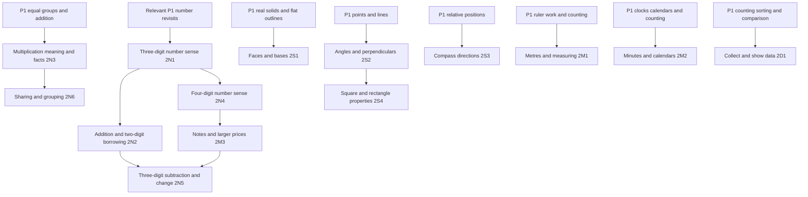

# P2 guided learning plan

Updated 21 November 2026. **Guided materials for 2N1, 2N2, 2S1, 2N3, 2M1, 2D1 and 2N4 are implemented across eight topics and 44 lessons. The remaining guided units are planned.** See the [four-digit release](p2-thousands-guided-release.md) and [pictogram release](p2-pictograms-guided-release.md) and [metres release](p2-metres-guided-release.md) and [multiplication release](p2-facts-guided-release.md). See the [arithmetic release](p2-arithmetic-guided-release.md). See the [first release and evidence](p2-number-guided-release.md). Start with three-digit number sense, while making shape, practical measurement and data routes available independently. Build explanations and experiences around the existing resources rather than treating a question bank as a teaching course.

## Starting point

P1 now has 15 guided pathways, 45 lessons and a [practical review](../p1-review.html). Its six screen questions suggest revisits; they are not a P2 admission test. An adult can use the separate observations to decide what support a pupil needs. A pupil may start a suitable P2 branch while revisiting P1 in another branch.

P2 already has 15 resource-bearing units, including inquiry, and [41 practice types](../p2-skill-levels.html) across the other 14 units. The existing bank contains 1,476 levelled tasks built from 492 contexts. These are available resources, not newly delivered lessons. The new work is the guided sequence, explanations, representations, practical prompts and connections between topics. Retain the existing resource and assessment IDs.

The coverage ledger below accounts for **59 numbered objectives plus the inquiry statement**. The [existing curriculum inventory](full-curriculum-plan.md) and linked unit briefs supply the detailed objective and resource maps. Their historical resource-complete labels do not mean that guided P2 teaching has already been implemented.

## Curriculum basis and sequencing decisions

The [EDB curriculum index](https://www.edb.gov.hk/en/curriculum-development/kla/ma/curr/index2.html), [primary supplement](https://www.edb.gov.hk/attachment/en/curriculum-development/kla/ma/curr/pmc2017_e.pdf) and [KS1 explanatory notes](https://www.edb.gov.hk/attachment/en/curriculum-development/kla/ma/curr/EN_KS1_e.pdf) were checked for this plan. The notes permit a logical teaching sequence rather than requiring the printed unit order (PDF page 5).

Two explicit connections determine the later number route: **2N4 before 2M3, then 2N5** (notes PDF pages 30–31). Our additional prerequisite choices are shown below; they are MathQuiz teaching decisions, not an EDB timetable.

Arrows recommend useful preparation; they do not lock topics. Metres also benefit from the hundred model in 2N1. Money builds on P1 coins as well as 2N4. Quadrilaterals need P1 flat shapes and ruler handling as well as angles. Clock learning can use concrete counting without waiting for completion of the multiplication tables.

**The shape sequence is a spiral.** P1 began with real solids, traced outlines and flat shapes. P2 revisits those objects to examine faces and bases, and separately develops angles before testing square/rectangle properties. We should not impose a new rule that every P2 solid lesson must precede every P2 flat-shape lesson. Face rubbing can use familiar outlines without requiring the later property lesson; that lesson can then lead back to a closer look at faces.

## Coverage and proposed teaching blocks

Each row is a delivery scope, not a promise of three lessons. Split lessons whenever one explanation would introduce several new ideas. Objective numbers refer to the linked unit brief; all rows have resources; **2N1 and 2N2 now have guided teaching, while the other rows remain planned**.

| Unit and objectives | Proposed teaching progression | Practical evidence and existing resource |
| --- | --- | --- |
| [2N1](p2-3digit-numbers.md), 1–5 | Build a hundred → read and sequence numbers → compare → count larger groups → estimate | Build and exchange bundles, read aloud, write from dictation and estimate a hidden-total collection. [Activity](../activities/p2-3digit-numbers.html). |
| [2N2](p2-addition-subtraction-ii.md), 1–4 | Extend carrying → choose useful addition pairs → exchange for two-digit subtraction → ordered subtraction and stories → check estimates | Use counters before independent written columns; explain what was exchanged and why the operation fits. [Activity](../activities/p2-addition-subtraction-ii.html). |
| [2N3](p2-basic-multiplication.md), 1–5 | Equal groups and repeated addition → construct facts starting with 2, 5 and 10 → remaining tables → 1 and 0 → swapped factors and stories | Build, draw and describe the groups. Show both valid factor orders without confusing group count and group size. [Activity](../activities/p2-basic-multiplication.html). |
| [2N4](p2-4digit-numbers.md), 1–4 | Build a thousand → cross the boundary forwards/backwards → group and compare | Trade hundred bundles, read/write numbers with empty places and count represented groups. [Activity](../activities/p2-4digit-numbers.html). |
| [2N5](p2-addition-subtraction-iii.md), 1–3 | Extend borrowing to hundreds → exchanges across zero → ordered mixed changes → money/change → reasonableness | Write own columns and explain a shopping calculation using separate dollar/cent parts. [Activity](../activities/p2-addition-subtraction-iii.html). |
| [2N6](p2-basic-division.md), 1–4 | Share equally → make groups of a given size → relate to multiplication → remainders and context → zero cases | Deal objects in rounds, then regroup the same total; explain what the answer and leftovers count. [Activity](../activities/p2-basic-division.html). |
| [2M1](p2-length-distance-iii.md), 1–4 | Need for a larger unit → metre reference → choose a tool and record → use a personal reference to estimate | Measure real lengths and gaps, calibrate an arm span or pace and compare an estimate with measurement. [Activity](../activities/p2-length-distance-iii.html). |
| [2M2](p2-time-ii.md), 1–10 | Read minutes → experience and measure intervals → finish/elapsed problems → times of day → months and years → event dates | Use a real clock/stopwatch and calendars; distinguish a time from a duration. Split into several releases if needed. [Activity](../activities/p2-time-ii.html). |
| [2M3](p2-money.md), 1–3 | Observe notes → read larger prices → count notes/coins → equal-value exchanges | Identify authentic notes with adult help and play shop; labelled rectangles alone do not assess note recognition. [Activity](../activities/p2-money.html). |
| [2S1](p2-3d-shapes-ii.md), 1–2 | Touch faces/surfaces → identify bases and other faces → name prisms/pyramids from bases | Turn objects and make rubbings; compare a base outline with the whole solid. [Activity](../activities/p2-3d-shapes-ii.html). |
| [2S2](p2-angles.md), 1–6 | Change an opening → compare → use a right-angle reference → perpendicular lines → make and draw → shortest connection | Use hinged strips, folding and ruler/set square, including a point on and a point off a line. [Activity](../activities/p2-angles.html). |
| [2S3](p2-directions-ii.md), 1–2 | Establish north → name other directions → describe relative locations → follow and explain a route | Orient and use a real compass, walk safely with an adult and distinguish turning from compass direction. [Activity](../activities/p2-directions-ii.html). |
| [2S4](p2-quadrilaterals-i.md), 1–4 | Segment connections → adjacent/opposite sides → test corners and lengths → draw/make shapes | Rotate examples, measure sides and check corners rather than judge by appearance. [Activity](../activities/p2-quadrilaterals-i.html). |
| [2D1](p2-pictograms.md), 1–3 | Collect and sort → organise symbols → read both orientations → construct and explain | Make a chart from a small real collection, including title, category labels and key. [Activity](../activities/p2-pictograms.html). |
| [2F1](p2-inquiry.md), inquiry statement | Predict → try → notice → explain within every suitable topic | Reuse the [inquiry activity](../activities/p2-inquiry.html); record observations separately from scores. Do not postpone all inquiry to a final standalone unit. |

## Boundaries carried forward from the audited unit briefs

Use the linked briefs above as the release checklist, including remarks rather than objective headings alone.

- Number work: 2N1 stays below 1000; 2N4 extends to 9999. Their group-counting activities should not require a multiplication algorithm. In 2N2, addition has at most three addends and a sum below 1000; subtraction uses at most three two-digit numbers. In 2N5, operations and intermediate results stay within three digits and nonnegative whole numbers. Keep later comparative-plus-total stories out of the core P2 route.
- Multiplication/division: use table facts through 10, including appropriate zero/one cases; never divide by zero. Division teaches both sharing and grouping, with and without leftovers. Do not introduce long division or fractional answers as P2 requirements.
- Measurement: metre work includes 100 cm = 1 m and compound-to-single-unit recording, not required reverse conversion or decimal lengths. Time includes analogue/digital reading, whole-minute intervals up to 60 minutes, times of day and calendar work. Exclude inverse starting-time problems and 24-hour notation conversion. Calendar tasks must state their event-day counting convention and include finding a missing date as well as a duration.
- Money: amounts are at most HK$1000; price notation does not introduce decimal arithmetic. Keep exchanges within the two permitted denomination groups described in the money brief. Give change in 2N5 after money recognition/counting. Recheck current note references when implementing authentic-note materials.
- Geometry/data: exclude degree measurement and protractors. Include perpendicular construction and shortest distance, not just angle labels. Do not introduce later square/rectangle inclusion testing, area or perimeter. Use non-oblique solid examples and avoid requiring later cube/cuboid subclassification. Pictograms use one symbol per item and both orientations; construction is required alongside reading.

## Lesson experience and learner navigation

Keep the established bilingual flow: short explanation with an object or diagram → guided practice → Easy, Normal and Difficult practice → topic check → targeted revisit or practical application. Difficulty changes the support and reasoning, not the time allowed. A worked example should explain the action; do not replace teaching with an Easy question and a hint.

Provide a P1/P2 selector and a P2 map grouped into Numbers and calculating, Shapes and positions, and Everyday maths and data. Show the suggested first topic and useful-first links, with a separate Continue action for each year. Preserve the existing P1 resume destination when a pupil briefly explores P2. Three learner slots remain three pupils, not three challenge levels.

Give each lesson a practical prompt and a precise existing activity link. Offer speaking, drawing or object handling before optional typing. Estimate before revealing a total or answer choices. Use unfamiliar transfer examples in checks; do not count recognition of a repeated bank context as independent mastery. Keep observations, hints used and automatically marked responses distinguishable. No automatic P2 promotion score or mandatory completion of every P1 branch.

## First implementation slice

**First slice implemented: 2N1, Three-digit number sense, with separate P2 navigation and storage.** Pupil title: **Hundreds and numbers to 999 / 百位與999以內的數**. Five short lessons allow the practical objectives to receive explicit teaching:

| Lesson | Teaching and representation | Evidence to collect |
| --- | --- | --- |
| Build a hundred | Ten tens become one hundred; compose 243 and 304 with visible groups | Build/read a model; distinguish the digit 3 from its value in 304; explain the empty tens place. |
| Read, count and notice | Read/write numerals, count forwards/backwards across a hundred and use the ones digit for parity | Complete a boundary sequence; read aloud/write from dictation; explain an odd/even judgement. |
| Compare and order | Say the comparison before choosing a symbol; compare the first different place | Contrast 305 and 350, include equality and order a small set in the stated direction. |
| Count bigger groups | Count groups of 20, 25, 50 and 100 with visible units and running totals | Point to and count each group; do not accept a multiplication-only response as observed counting. |
| Estimate then check | Use a known reference collection, record an estimate, then count and revise | Record the original estimate and explanation before showing the total; assess the method, not a fixed accuracy cutoff. |

The exact lesson IDs, item totals and check length are implementation decisions. Do not force these five lessons into the P1 convention of three lessons and six quiz answers. Record objective coverage and task counts after authoring and verification.

## Implementation prerequisites found in the current source

Baseline: repository commit `53213b388589ea79842bbca54d085585f2897fdb`.

1. `learn-data.js` currently accepts numeric answers only up to 100. `learn-store.js` truncates saved answer strings to three characters and holds explicit P1 lesson/path lists. Inspect `learn.js` inputs and all serializers too. Support P2-sized and later structured answers deliberately; widening a validator alone is insufficient.
2. Adopt a separate versioned P2 progress record, with stable P2 lesson IDs and per-learner data. Reuse the selected learner slot, but preserve P1 bytes and cursors. This prevents an old P1 tab from cleaning unfamiliar P2 fields out of a shared record. Define year-specific reset wording and cross-tab stale-state handling before release.
3. Make check length and saved-answer limits explicit per topic/version. Persisted answer order must not silently change. Calculate a bounded record size from the supported P2 schema; reject malformed records without clearing valid P1 work.
4. Keep practice-bank scores separate from guided-lesson completion. Existing P2 practice is reusable extension material, not automatic credit for teaching, oral work or inquiry.
5. Add accessible representations and answer controls as topics need them: comparison symbols, multiple parts, clocks and chart construction cannot all be represented truthfully by a single small-integer box. Preserve keyboard and non-drag alternatives.

## Delivery order and acceptance gates

Development order is not a compulsory pupil timetable. After the first slice, alternate branches so the implementation does not imply that pupils must finish all arithmetic before shapes or practical maths.

1. **Foundation release:** P2 navigation/storage plus the five 2N1 lessons. Link P1 number/ruler revisits and existing P2 activities.
2. **Early parallel releases:** 2N2 and multiplication meaning/facts; 2S1 faces/bases; 2M1 metres; 2D1 data. Give multiplication several short sessions rather than one table-drill block.
3. **Connected extensions:** 2N4 → 2M3 → 2N5, with 2N2 already available; 2N6 after multiplication meaning and usable facts; 2S2 → 2S4. Continue selected earlier topics between these releases.
4. **Remaining branches and synthesis:** complete the time/calendar blocks and compass route, then review P2 coverage and unfamiliar application. Inquiry and practical prompts accompany every release, not only this final stage.

For each release, require a source-to-lesson objective map, independently checked answers, English/Traditional Chinese review, and honest separation of screen and practical evidence. Check old P1 links, stored answers/cursors/notes, three-pupil isolation, year switching, blocked storage, stale tabs, reload/language continuity and reset scope. Test every new response type and relevant boundary, including zero, equality and largest permitted values. Inspect mobile layouts and keyboard operation. Verify the deployed files and new flow before claiming publication; record exact failures and reruns.

For the first slice specifically, test saving/reopening 304 and 999 without truncation, full P1 records alongside new P2 work, a five-lesson topic/check, comparisons in both directions and equality, all four group sizes, forward/backward boundaries, and an estimate saved before reveal. Run the existing affected learning/review suites as regression checks; their previous 286-case result is historical, not evidence for the new implementation.

Classroom trials, difficulty calibration, independent translation, screen-reader listening and physical printing remain pending. These can proceed alongside development; they must inform subsequent revisions before describing the course as classroom validated.

## Handoff

- [x] Review the P1 handoff and existing P2 resources.
- [x] Map all 15 P2 units and choose prerequisite connections.
- [x] Specify the first teaching slice and compatibility requirements.
- [x] Implement and verify the first slice above; see its dated release evidence.
- [x] Deliver 2N2 with six guided lessons and separate arithmetic progress.
- [x] Deliver 2S1 solid faces/bases as the third P2 topic, alternating branches.
- [x] Deliver the first 2N3 slice: equal groups, arrays and initial 2/5/10 facts.
- [x] Deliver remaining 2–10 facts across sessions, then multiplication by 1 and 0, with a complete construction workshop.
- [x] Deliver guided metres and distance (2M1), including separate personal-reference and estimate/measure records.
- [x] Deliver the guided pictogram branch (2D1), with both construction forms.
- [x] Deliver four-digit numbers (2N4), including boundary counting and larger-group running totals.
- [ ] Next: Money (II), 2M3, before later subtraction/change (2N5).
- [ ] Deliver the remaining branches with objective-level teaching evidence.
- [ ] Conduct pupil/manual validation and revise from observations.

The first implementation adds five lessons, 45 practice tasks, 10 guided tasks and a 10-question check, with separate P2 progress. Existing P1 content and P2 practice banks remain as released. Verification details and remaining manual limits are recorded in the first release report.

## Second implementation checkpoint

2N2 now has six lessons, 54 practice tasks, 12 guided tasks and a separate 12-question check. Its arithmetic records cannot be erased by older number-topic tabs. Addition stays below 1000; subtraction operands stay within two digits. See the [release report and manual limits](p2-arithmetic-guided-release.md). The subsequent shapes checkpoint below completes the next branch release.

## Third implementation checkpoint

2S1 now has five bilingual lessons, 45 practice tasks, ten guided tasks and a ten-question check. It follows P1 real solids → traced outlines → P2 selected bases/lateral faces → names → turn and explain. The new topic is open independently of arithmetic and preserves all earlier saved work. The [release report](p2-faces-guided-release.md) distinguishes supplied-family screen tasks from real-object observation; [evidence](p2-faces-guided-evidence.json) records 596 verified local/public cases and remaining manual limits.

The fourth checkpoint below delivers the start of 2N3; staged fact work and the metres/pictogram branches remain. The later number/money and angle/quadrilateral prerequisite connections remain unchanged.

## Fourth implementation checkpoint

The first guided 2N3 slice has five bilingual lessons, 45 practice tasks, ten guided tasks and a ten-question check. It connects equal groups and repeated addition, accepts both relevant factor orders, turns arrays and starts 2/5/10 facts with explained stories. Group-count/group-size fields remain ordered; unrelated factor pairs with the same total are rejected. See the [release report](p2-multiply-guided-release.md) and [691-case local/public evidence](p2-multiply-guided-evidence.json).

This fourth checkpoint was partial guided coverage of 2N3. The fifth checkpoint below supplies the remaining table teaching; neither checkpoint is evidence of pupil recall. Metres and pictograms remain early parallel releases.

## Fifth implementation checkpoint

[Build and use multiplication facts](../p2-learn.html?path=facts) adds seven bilingual lessons, 63 practice tasks, 14 guided tasks and a 12-question sample check. The recommended route builds 3/4, 6/8 and 7/9 across short sessions, constructs the 2–10 table, then explores one and zero. The workshop exposes 81 core cells, 19 additional one cells and 21 zero cells: all 121 ordered pairs, without prefilled answers. A final full workshop supports revisits.

Both multiplication topics together provide guided materials for the five 2N3 objectives. Construction records, self-reported methods, sampled check scores, written explanations and adult observations remain distinct. No automatic whole-table recall or pupil mastery claim is made. Progress in all earlier topics is preserved. See the [release report](p2-facts-guided-release.md) and [828-case local/public evidence](p2-facts-guided-evidence.json).

Next deliver guided metres and distance (2M1), then pictograms. Keep the later number/money and angle/quadrilateral prerequisite connections; pupils can enter appropriate branches without completing all arithmetic.

## Sixth implementation checkpoint

[Metres, lengths and distances](../p2-learn.html?path=metres) adds six bilingual lessons, 54 practice tasks, 12 guided tasks and a 12-question sample check. The route starts with a real one-metre reference, tools and actual measurement experience, then mixed-unit records, personal-reference calibration and estimate-before-measure trials. All four 2M1 objectives have guided materials; observed physical performance remains separate and pending.

The practical notebook records prior measuring experience, two reference readings and an approximate reference. Object-length and straight-distance trials preserve their first estimate and reference snapshot when measured results are recorded. No practical accuracy score or independent tool-skill claim is inferred. More trials use the linked existing worksheet. Earlier progress remains preserved.

P2 now has six topics, 34 lessons and 306 practice tasks. See the [release report](p2-metres-guided-release.md) and [940-case local/public evidence](p2-metres-guided-evidence.json). Next deliver **pictograms (2D1)**, keeping the data branch available independently of arithmetic completion. Later four-digit numbers precede money/subtraction, and angles precede quadrilateral properties.

## Seventh implementation checkpoint

[Organise and make pictograms](../p2-learn.html?path=pictograms) adds five bilingual lessons, 45 practice tasks, ten guided tasks, ten sample-check items and two blank chart builders. Mixed model cards introduce organisation before title/key/category recognition and interpretation in both orientations. Learners construct horizontal and vertical charts by placing whole symbols one at a time; each symbol represents one card. Counts, including zero and ties, remain small.

The builders supply labels, key and alignment; adult review of title wording and independent paper construction remains necessary. Practical prompts link the existing activity sheet. Earlier P1/P2 progress is preserved. See the [release report](p2-pictograms-guided-release.md) and [1,034-case local/public evidence](p2-pictograms-guided-evidence.json).

All early parallel branches now have guided materials. Next implement **2N4 four-digit numbers**, then 2M3 money and 2N5 subtraction/change. Division follows multiplication foundations; angles precede quadrilateral properties. Classroom validation remains pending, independently of development order.

## Eighth implementation checkpoint

[Thousands and four-digit numbers](../p2-learn.html?path=thousands) adds five bilingual lessons, 45 practice tasks, ten guided tasks and ten sample-check items. Ten hundred grids form a thousand; place-value work includes zero hundreds/tens and the 9999 upper limit. Boundary questions cross between three and four digits in both directions. Larger-group tasks require each running total in 200s, 250s, 500s or 1000s, without requiring multiplication notation. Comparisons start with spoken relationships before symbols.

Only this topic enables four-digit answers. All earlier topic data and the shared store remain unchanged, including separate learner progress. Compact diagrams and typed answers do not replace oral reading, hidden dictation or physical-model observation. See the [release report](p2-thousands-guided-release.md) and [1,126-case local/public evidence](p2-thousands-guided-evidence.json).

Next implement **Money (II), 2M3**, now that guided four-digit number materials are available; follow with three-digit subtraction/change (2N5). Division follows multiplication foundations and angles precede quadrilateral properties. Classroom validation remains pending.
