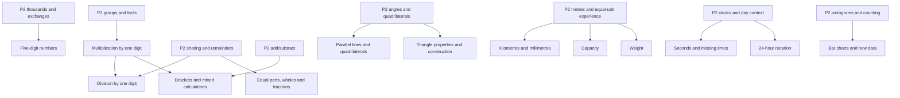

# P3 guided learning plan

Prepared 22 November 2026 from the published P2 readiness handoff (`2a3e7123647dccd55749d57bbafb0b06734c9ad5`). **Planning only:** no P3 guided lessons or runtime changes are introduced by this document. Next release: five lessons on five-digit numbers.

## Decision and source basis

Plan **13 numbered-content units (54 objectives), plus integrated inquiry 3F1**: 14 curriculum units altogether. Organise teaching into open branches, not a compulsory one-way checklist. A pupil may revisit selected [P2 review tasks](../p2-review.html) without a pass score or access lock.

Authority: [EDB primary curriculum supplement](https://www.edb.gov.hk/attachment/en/curriculum-development/kla/ma/curr/pmc2017_e.pdf#page=43) and [Key Stage 1 explanatory notes, P3 begins at PDF page 49](https://www.edb.gov.hk/attachment/en/curriculum-development/kla/ma/curr/EN_KS1_e.pdf#page=49). The notes were rechecked for all P3 units on this date; curriculum rows are not a prescribed teaching order. The unit audits linked below retain detailed supplement references. A repeat targeted retrieval of the supplement timed out; this planning pass uses the successfully retrieved official explanatory notes for the numbered scope and boundaries, rather than claiming a new full supplement reread.

The order below is a MathQuiz teaching proposal. It is not an EDB-endorsed timetable or measured pupil-readiness finding. Suggested lesson groupings are adjustable after classroom evidence. Keep concrete actions, diagrams, language and symbols connected.

## What already exists

The current [P3 skill directory](../p3-skill-levels.html) has **50 skills and 1,800 bilingual tasks** in its source module. This includes the original **35 curriculum skills / 1,260 levelled tasks** and **15 TSA-informed additions / 540 tasks**. Easy/Normal/Difficult often reuse a context; these are not 1,800 independent unseen contexts or guided lessons. The module's 14 labels include `3R1`, a cumulative-review grouping, **not an extra EDB unit**. Inquiry is separately teacher-observed.

Existing [source classification](p3-source-classification.md) separates EDB scope, HKEAA assessment references and MathQuiz extensions. Do not make symbolic fraction scaling, expanded pictogram/chart scales or cumulative TSA coverage compulsory P3 prerequisites merely because they appear in this bank. Preserve all IDs, payloads, scoring contracts, links and source labels. The lesson journey should teach first, then link to selected existing practice with its limits clear.

There are existing practical activities for all 14 curriculum units; these are resources, not recorded delivery or pupil performance. No `p3-learn.html` guided entry exists in the audited source. The new work is guided teaching and its separate progress, not another relabelling of the practice bank.

## Learning branches and prerequisites

- **First release is 3N1**, establishing a consistent P3 entry and grade-isolated progress. This is a delivery choice, not a requirement to finish five-digit counting before every other branch.
- **Number operations:** meaningful partial products and carrying before column multiplication; place-value sharing before column division. Multiplication grouping may change; successive division remains left-to-right. Mixed calculations need multiplication meaning and earlier addition/subtraction, not completion of every division lesson.
- **Fractions:** bring them in once equal sharing and identifying a whole are secure. Do not postpone this concrete branch until all written algorithms are completed. Equal partitions → object/set wholes → notation → modelled equivalence → comparisons → pictured operations.
- **Geometry:** revisit P2 angles, lengths and square/rectangle properties. Parallel lines precede new quadrilateral classifications. Triangle work can run alongside; it does not require advanced quadrilateral completion. Keep real models/drawing in the route. There is no new P3 solids unit and no reason to undo P1's solids-to-outlines sequence.
- **Measures, time and data:** open parallel routes with useful-first links. Standard scales need appropriate counting, not completion of all arithmetic. Time (III) and (IV) share P2 prerequisites; seconds arithmetic must not be mixed into the time-problem requirement. P2 pictograms lead into bar charts, with counting in twos/fives revisited where needed.
- Inquiry belongs within these routes, from the first release onward. It is not a final optional reward after all quizzes or proof that ten teaching hours were delivered.

## Unit routes and resources

The labels below paraphrase the planning focus; use the cited objective numbers and detailed unit audits when implementing.

| Unit | Useful first | Suggested teaching route | Existing resources |
| --- | --- | --- | --- |
| 3N1 · Five-digit numbers | P2 thousands | Build 10000 → read/write zero places → cross boundaries → parity → compare | [Source audit](p3-5digit-numbers.md) · [Activity](../activities/p3-5digit-numbers.html) · [EDB notes](https://www.edb.gov.hk/attachment/en/curriculum-development/kla/ma/curr/EN_KS1_e.pdf#page=49) |
| 3N2 · Multiplication | P2 equal groups, facts and exchanges | Two-digit products → carrying → three-digit products → helpful grouping → stories and reasonableness | [Source audit](p3-multiplication-i.md) · [Activity](../activities/p3-multiplication-i.html) · [EDB notes](https://www.edb.gov.hk/attachment/en/curriculum-development/kla/ma/curr/EN_KS1_e.pdf#page=50) |
| 3N3 · Division | P2 sharing/grouping and 3N2 inverse checks | Place-value sharing → exchanges/quotient zeros → remainders → successive division → contextual decisions | [Source audit](p3-division-i.md) · [Activity](../activities/p3-division-i.html) · [EDB notes](https://www.edb.gov.hk/attachment/en/curriculum-development/kla/ma/curr/EN_KS1_e.pdf#page=51) |
| 3N4 · Mixed calculations | P2 addition/subtraction and 3N2 | Four-digit add/subtract → brackets → multiplication first → concrete equalities → comparison then total | [Source audit](p3-four-operations-i.md) · [Activity](../activities/p3-four-operations-i.html) · [EDB notes](https://www.edb.gov.hk/attachment/en/curriculum-development/kla/ma/curr/EN_KS1_e.pdf#page=52) |
| 3N5 · Fractions | P1 parts/whole and P2 equal sharing | Equal parts and whole → notation including 0/1 → set fractions → equivalence → comparisons → pictured operations | [Source audit](p3-fractions-i.md) · [Activity](../activities/p3-fractions-i.html) · [EDB notes](https://www.edb.gov.hk/attachment/en/curriculum-development/kla/ma/curr/EN_KS1_e.pdf#page=54) |
| 3M1 · Kilometres and millimetres | P1 centimetres, P2 metres and number scales | Need for km → km comparisons → need for mm → actual ruler use → estimates and records | [Source audit](p3-length-distance-iv.md) · [Activity](../activities/p3-length-distance-iv.html) · [EDB notes](https://www.edb.gov.hk/attachment/en/curriculum-development/kla/ma/curr/EN_KS1_e.pdf#page=56) |
| 3M2 · Seconds and time problems | P2 minutes and day context | Experience seconds → actual timing → finish/elapsed revisit → unknown starting time → explain/check | [Source audit](p3-time-iii.md) · [Activity](../activities/p3-time-iii.html) · [EDB notes](https://www.edb.gov.hk/attachment/en/curriculum-development/kla/ma/curr/EN_KS1_e.pdf#page=58) |
| 3M3 · Capacity | P2 equal units, counting/scales and thousands | Container/maximum → intuitive/direct comparisons → equal units → L/mL → tools → estimate/record | [Source audit](p3-capacity.md) · [Activity](../activities/p3-capacity.html) · [EDB notes](https://www.edb.gov.hk/attachment/en/curriculum-development/kla/ma/curr/EN_KS1_e.pdf#page=59) |
| 3M4 · Twenty-four-hour time | P2 clock reading, day parts and midnight | Ambiguity → hour/minute pairs → relate both notations → noon and named-day endpoints | [Source audit](p3-time-iv.md) · [Activity](../activities/p3-time-iv.html) · [EDB notes](https://www.edb.gov.hk/attachment/en/curriculum-development/kla/ma/curr/EN_KS1_e.pdf#page=61) |
| 3M5 · Weight | P2 equal units, counting/scales and thousands | Handle/predict → balance → equal units → g/kg → scale use → estimate/record | [Source audit](p3-weight.md) · [Activity](../activities/p3-weight.html) · [EDB notes](https://www.edb.gov.hk/attachment/en/curriculum-development/kla/ma/curr/EN_KS1_e.pdf#page=62) |
| 3S1 · Parallel lines and quadrilaterals | P2 angles, perpendiculars and quadrilateral properties | Parallel/not parallel → tool construction → two parallel pairs → inclusive names → one pair → draw/make | [Source audit](p3-quadrilaterals-ii.md) · [Activity](../activities/p3-quadrilaterals-ii.html) · [EDB notes](https://www.edb.gov.hk/attachment/en/curriculum-development/kla/ma/curr/EN_KS1_e.pdf#page=64) |
| 3S2 · Triangles | P1 triangles, P2 angles/lengths; 3S1 naming helps | Sides versus angles → overlapping names → side feasibility → varied drawings/models | [Source audit](p3-triangles.md) · [Activity](../activities/p3-triangles.html) · [EDB notes](https://www.edb.gov.hk/attachment/en/curriculum-development/kla/ma/curr/EN_KS1_e.pdf#page=66) |
| 3D1 · Bar charts | P2 pictograms and counting in 1/2/5 | Pictogram bridge → bars and scale → both orientations → tallies/table → choose scale and construct | [Source audit](p3-bar-charts-extension.md) · [Activity](../activities/p3-bar-charts-i.html) · [EDB notes](https://www.edb.gov.hk/attachment/en/curriculum-development/kla/ma/curr/EN_KS1_e.pdf#page=68) |

## Objective ledger

Every numbered objective is assigned below; this is planned teaching coverage, not a completion claim. Practical evidence is assessed separately from screen responses.

| Objective | Guided focus | Required application evidence for its unit |
| --- | --- | --- |
| 3N1.1 | Read, write and count five-digit quantities | Model exchange, unseen oral reading/dictation and comparison explanation |
| 3N1.2 | Explain the ten-thousands place | Model exchange, unseen oral reading/dictation and comparison explanation |
| 3N1.3 | Compare values | Model exchange, unseen oral reading/dictation and comparison explanation |
| 3N2.1 | Multiply by one digit | Construct partial products and write own columns; explain a chosen grouping |
| 3N2.2 | Group three factors | Construct partial products and write own columns; explain a chosen grouping |
| 3N2.3 | Solve multiplication situations | Construct partial products and write own columns; explain a chosen grouping |
| 3N3.1 | Divide by one digit | Share materials, write quotient places and interpret a leftover in context |
| 3N3.2 | Divide successively | Share materials, write quotient places and interpret a leftover in context |
| 3N3.3 | Solve division situations | Share materials, write quotient places and interpret a leftover in context |
| 3N4.1 | Use brackets to show intended order | Select operations without an operation heading; explain intermediate quantities |
| 3N4.2 | Combine three addition/subtraction terms | Select operations without an operation heading; explain intermediate quantities |
| 3N4.3 | Combine multiplication with addition or subtraction | Select operations without an operation heading; explain intermediate quantities |
| 3N4.4 | Solve linked calculation situations | Select operations without an operation heading; explain intermediate quantities |
| 3N5.1 | Describe part of an object or set | Fold/partition, identify the whole set, overlay equal wholes, explain before writing |
| 3N5.2 | Show equal fractional amounts | Fold/partition, identify the whole set, overlay equal wholes, explain before writing |
| 3N5.3 | Compare with a shared numerator or denominator | Fold/partition, identify the whole set, overlay equal wholes, explain before writing |
| 3N5.4 | Add or subtract like-denominator fractions | Fold/partition, identify the whole set, overlay equal wholes, explain before writing |
| 3M1.1 | Develop a kilometre reference | Choose real tools, record a reference then an estimate before measuring |
| 3M1.2 | Compare kilometre lengths/distances | Choose real tools, record a reference then an estimate before measuring |
| 3M1.3 | Develop a millimetre reference | Choose real tools, record a reference then an estimate before measuring |
| 3M1.4 | Measure and compare in millimetres | Choose real tools, record a reference then an estimate before measuring |
| 3M1.5 | Choose suitable length records | Choose real tools, record a reference then an estimate before measuring |
| 3M2.1 | Develop a sense of a second | Real timing and pupil-generated timelines; distinguish measurement from word problems |
| 3M2.2 | Measure and compare in seconds | Real timing and pupil-generated timelines; distinguish measurement from word problems |
| 3M2.3 | Find a missing start, finish or duration | Real timing and pupil-generated timelines; distinguish measurement from word problems |
| 3M3.1 | Explain capacity | Safe containers, full-to-empty transfer, equal fills and eye-level reading |
| 3M3.2 | Predict clear capacity differences | Safe containers, full-to-empty transfer, equal fills and eye-level reading |
| 3M3.3 | Compare by direct transfer | Safe containers, full-to-empty transfer, equal fills and eye-level reading |
| 3M3.4 | Compare using a repeated nonstandard unit | Safe containers, full-to-empty transfer, equal fills and eye-level reading |
| 3M3.5 | Recognise L and mL | Safe containers, full-to-empty transfer, equal fills and eye-level reading |
| 3M3.6 | Measure and compare with standard units | Safe containers, full-to-empty transfer, equal fills and eye-level reading |
| 3M3.7 | Choose suitable capacity records | Safe containers, full-to-empty transfer, equal fills and eye-level reading |
| 3M4.1 | Explain why 24-hour notation is useful | Read/write actual schedules and explain 00:00 versus the stated day-end 24:00 |
| 3M4.2 | Read and express 24-hour times | Read/write actual schedules and explain 00:00 versus the stated day-end 24:00 |
| 3M5.1 | Explain heavier and lighter | Check zero, centre objects, swap pans, choose scale and estimate after experience |
| 3M5.2 | Predict clear weight differences | Check zero, centre objects, swap pans, choose scale and estimate after experience |
| 3M5.3 | Compare on a balance | Check zero, centre objects, swap pans, choose scale and estimate after experience |
| 3M5.4 | Compare using equal-weight units | Check zero, centre objects, swap pans, choose scale and estimate after experience |
| 3M5.5 | Recognise g and kg | Check zero, centre objects, swap pans, choose scale and estimate after experience |
| 3M5.6 | Measure and compare with scales | Check zero, centre objects, swap pans, choose scale and estimate after experience |
| 3M5.7 | Choose suitable weight records | Check zero, centre objects, swap pans, choose scale and estimate after experience |
| 3S1.1 | Identify parallel lines | Ruler/set-square construction and separate physical models with explicit criteria |
| 3S1.2 | Construct parallel lines | Ruler/set-square construction and separate physical models with explicit criteria |
| 3S1.3 | Use parallelogram properties | Ruler/set-square construction and separate physical models with explicit criteria |
| 3S1.4 | Include squares and rectangles as parallelograms | Ruler/set-square construction and separate physical models with explicit criteria |
| 3S1.5 | Identify trapeziums | Ruler/set-square construction and separate physical models with explicit criteria |
| 3S1.6 | Draw and make the quadrilaterals | Ruler/set-square construction and separate physical models with explicit criteria |
| 3S2.1 | Recognise the five specified triangle categories | Sort with all applicable names, predict/test strips including equality boundary |
| 3S2.2 | Reason about overlapping categories | Sort with all applicable names, predict/test strips including equality boundary |
| 3S2.3 | Test whether side lengths can form a triangle | Sort with all applicable names, predict/test strips including equality boundary |
| 3S2.4 | Draw and make triangles | Sort with all applicable names, predict/test strips including equality boundary |
| 3D1.1 | Explain a bar chart representation | Collect new data, tally it and make both chart orientations with own labels |
| 3D1.2 | Read and compare bar-chart data | Collect new data, tally it and make both chart orientations with own labels |
| 3D1.3 | Collect, organise and chart data | Collect new data, tally it and make both chart orientations with own labels |

**3F1 (unnumbered integrated statement):** each topic includes a pupil question or choice, retained prediction, actual trial, noticed result, explanation and a changed example or counterexample. Use the [existing investigation resource](../activities/p3-inquiry.html) and [audit](p3-inquiry.md) as models. Preserve failed trials and record support; do not fabricate observations, auto-award inquiry mastery or claim hours from clicks.

## Scope boundaries that must shape the lessons

- **3N1:** up to five digits, with movement back across 10000 into four digits. Read/write/count, internal zeros, place value, odd/even from ones, comparison symbols. Ten thousand represented by ten groups valued at 1,000 each; do not demand 10000 loose objects. No new arithmetic algorithm or estimation objective is added here.
- **3N2/3N3:** two/three-digit by one-digit calculations, including exchanges and remainders where appropriate; written steps must connect to values. Teach estimation after calculation experience. Quotient zeros and the meaning of leftover quantities need explicit attention. No zero divisor or multi-digit divisor.
- **3N4:** three-number addition/subtraction through four-digit numbers; multiplication combined with addition or subtraction with at most four numbers. Brackets may occur in separate pairs, not nested levels. Recognise the four concrete product/sum/difference relations; procedural expansion/factoring belongs later. Comparison-then-total stories extend P2. The title does not require a mixed-division bank.
- **3N5:** fractions of one object and one set, equal parts and consistent whole. Include zero and one. Comparisons share numerator or denominator. Equivalence uses models, not a required expand/reduce algorithm. Pictured addition OR subtraction of up to three like-denominator fractions; all intermediate values/results stay between zero and one. No forced simplest form, unlike denominators or improper/mixed-number work. Preserve earlier count-specific fraction marking rather than silently broadening it.
- **Length/capacity/weight:** direct and equal-unit experience before standard recording, then estimate before measuring a new case. Choose actual tools and meaningful references. Compound-to-single unit records are included; reverse conversion and decimal records are not required. Capacity concerns maximum contents, not current fill. Weight uses ordinary language and balanced equal units; avoid turning this into a mass/force physics lesson.
- **3M2:** actual seconds measurement is reasonable but has no fixed curricular maximum. The separate start/finish/duration word problems use whole hours up to 12 or whole minutes up to 60, not seconds arithmetic. Missing start is the new P3 demand; preserve the two existing unknown types too.
- **3M4:** relate 12/24-hour notation, hour/minute pairs, noon, and named-day start/end (00:00/24:00). Do not require interval arithmetic in 24-hour notation; that is later learning.
- **3S1:** parallel lines lie in the same plane; non-intersection must not be judged just from two short visible segments. Discuss perpendicular separation, draw/make parallels, then two parallel pairs and exactly one pair. Squares and rectangles count as parallelograms. This does not introduce the later square-within-rectangle teaching requirement. Avoid single-name questions without specified criteria; drawing tasks say whether a non-right-angled example is required.
- **3S2:** five named categories, including isosceles-right; equilateral is also isosceles. Allow all valid names. Side-sum feasibility is strict, including failure at equality, and is applied in making models. No degree measures, angle sums, Pythagoras, formal proof or advanced classification added.
- **3D1:** horizontal/vertical charts with scale 1, 2 or 5. Collect data, tally/frequency table, choose a scale, label and construct with equal bar widths/spaces. Reading a provided endpoint does not prove constructing a chart. Other scales in extension practice stay labelled extensions.

## Delivery batches

1. **Five-digit numbers and P3 foundation infrastructure** — five lessons below; separate grade storage and map entry. Include a small practical investigation immediately.
2. **Multiplication and a parallel measurement route** — first multiplication meaning/columns, then kilometre/millimetre lessons. Release each verified topic separately.
3. **Division plus fractions foundations** — develop column sharing and remainder reasoning; open concrete whole/part fraction lessons without an algorithm-completion lock.
4. **Parallel lines/quadrilaterals and triangle reasoning** — separate topic releases, with instruments and construction observations.
5. **Capacity and weight** — each follows its comparison-to-tool sequence; reusable observation patterns, not reused results.
6. **Time (III), Time (IV) and bar charts** — each has its own prerequisite links and scope; these can be brought forward for a pupil/class ready for them.
7. **Complete mixed calculations and fraction applications, then whole-P3 review** — ensure no objective is left merely in the practice bank. Audit sequence, fresh application, oral/practical evidence and navigation before moving to P4 guided teaching.

This is an implementation queue, not a compulsory pupil schedule. Later objectives may be taught earlier through the open branches. Each topic release updates the objective ledger, names any intentionally partial scope and leaves no false whole-unit completion badge.

## First implementation contract: five-digit numbers

Proposed entry `p3-learn.html?path=numbers`, with EN/Traditional Chinese, three existing learner slots, useful-first links to [P2 thousands](../p2-learn.html?path=thousands) and [P2 review](../p2-review.html?session=number). Keep P2 Continue independent. Proposed new IDs must be collision-checked against the repository before use:

| Proposed lesson | Teaching/practical task | Focused response/application |
| --- | --- | --- |
| `p3-tenthousand` | Exchange ten labelled 1000 units for one 10000 model; explain unchanged total | Distinguish digit from its ten-thousands value |
| `p3-readfive` | Five-column records including internal zeros; unseen oral reading and dictation | Repair a dropped-zero record; write the numeral |
| `p3-crossfive` | Count forward/back in ones and larger equal steps, including four/five-digit boundaries | Complete and explain a changed sequence |
| `p3-oddevenfive` | Pairing/ones link; challenge a leading-digit argument | Determine parity and explain the deciding place |
| `p3-comparefive` | Compare the highest differing place, including equality and near boundaries | Select symbols/order and justify a comparison |

Planned teaching pattern per lesson: concise explanation and controllable model → two guided examples → three Easy, three Normal and three Difficult practice items → practical prompt and separate notes. This proposes 45 practice items and ten guided examples, not an executed inventory. Add a small ten-item topic check with different contexts from guided/practice; audit repetitions explicitly and preserve first attempts separately from supported retries. Do not call it a mastery certificate. Include a number-card investigation that preserves a prediction before testing and keeps evidence outside scores.

Reuse the style and sound interaction patterns of P2, but **do not load the P2 topic loader and change its global data in place**. Choose explicit grade configuration or isolated P3 modules. The current P2 renderer whitelists `maxAnswer` values 1000/9999 and otherwise falls back to 999; setting 99999 on a new data object alone would silently reject legitimate five-digit answers. Add bounded five-digit support in the P3 contract, with tests at 9999/10000/99999 and rejection of 100000. Keep lower-grade limits unchanged.

Use a separate versioned P3 guided record per learner and topic, and separate test keys. Never migrate bank scores into lesson completion, infer mastery from existing practice, or overwrite P1/P2 keys. Cover malformed/future/oversized records, unavailable storage, stale tabs, reload, language/learner changes, scoped reset and record size. Define numeric-answer normalisation deliberately (including full-width digits if supported); oral writing/dictation is separate evidence from numerical equivalence.

Inputs, label text, diagrams and phone layouts must support five places without crowding. A diagram's accessible description should convey the task without simply announcing the answer. Notes should record actual words/actions and help; paper drawings and adult transcription remain legitimate. Do not equate a rendered model with real manipulative experience.

## Acceptance and release checklist

- Trace every lesson, practice/check item and practical prompt to 3N1.1–3; audit numerical answers with an independent place-value/counting/comparison oracle and both language texts.
- Test blank/wrong/correct attempts, allowed numeric forms, malformed inputs, five-place bounds, stable IDs, first/retry distinction, targeted revisits and all route parameters.
- Compare check contexts with worked/guided/practice examples and the existing activity keys. Document remaining scaffolding rather than claiming novelty from a different ID.
- Test P3 storage isolation and preservation of P1/P2 lesson scores, cursors, observations, inquiries and existing P3 bank/Smart-practice records. Verify boundary learners and stale-tab/reset behaviour.
- Exercise keyboard input/focus, EN/Traditional Chinese, narrow and wide views, diagram labels, linked practical materials and independent Continue routes. Run appropriate shared regressions locally and publicly; report original failures and exact reruns without inflating distinct counts.
- Publish runtime and documentation, verify deployment and exact content readbacks, update README with the next unfinished topic. Test records use owned test keys and are restored; close only task-owned tabs/servers.
- Keep source/resource checks separate from pupil trials, independent translation, screen-reader listening, physical printing and observed practical skills. Those remain pending and inform subsequent revision, not a false claim that P3 has been fully validated.

## Verification of this planning release

The companion evidence records objective/unit counts, existing source inventory, relative-link validation and a runtime-preservation comparison. This release changes planning documents only; it does not claim any new lesson tests, pupil results or teaching delivery. Historical resource audits above remain useful but their old test totals are not new execution results.
