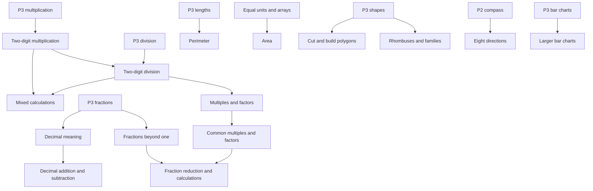

# P4 guided learning plan

25 November 2026. [P5 and P6 plans are now complete](p4-p6-guided-sequence.md); **P4 multiplication is implemented** in [six guided lessons](../p4-learn.html?path=multiply). [Release and evidence](p4-multiply-guided-release.md). [Division now adds seven guided lessons](p4-division-guided-release.md), making thirteen P4 lessons. [Multiples and factors now adds six lessons](p4-factors-guided-release.md), making nineteen P4 lessons. [Common multiples and factors adds six lessons](p4-common-guided-release.md), making twenty-five P4 lessons. [Fractions beyond one adds six lessons](p4-fractions-guided-release.md), making thirty-one P4 lessons. [Fraction calculations and stories adds six lessons](p4-fractionops-guided-release.md), making thirty-seven P4 lessons and completing guided 4N6 resource coverage. [Perimeter adds six lessons](p4-perimeter-guided-release.md), making forty-three P4 lessons. [Area adds eight lessons](p4-area-guided-release.md), making fifty-one P4 lessons. [Rhombuses and shape families add six lessons](p4-shapes-guided-release.md), making fifty-seven P4 lessons. [Cut-and-build shapes add six lessons](p4-cutbuild-guided-release.md), making sixty-three P4 lessons. [Eight directions add six lessons](p4-directions-guided-release.md), making sixty-nine P4 lessons. [Decimal meaning adds six lessons](p4-decimals-guided-release.md), making seventy-five P4 lessons. [Decimal addition and subtraction adds six lessons](p4-decimalops-guided-release.md), making eighty-one P4 lessons. Next: larger bar charts. The remaining topics below are planned. Continue guided teaching through P4, P5 and P6 before another general revision of P1–P3, as requested. Carry the shorter pupil wording into every new release.

This plan assigns **53 numbered objectives across 14 content units**, with **4F1 inquiry integrated throughout**. It proposes teaching routes and a concrete first release. The existing [P4 practice bank](../p4-skill-levels.html) and practical sheets remain available; their resource-complete status does not mean that a guided course already exists.

## Source and starting point

Use the [EDB curriculum supplement, P4 at PDF pages 60–76](https://www.edb.gov.hk/attachment/en/curriculum-development/kla/ma/curr/pmc2017_e.pdf#page=60) and [KS2 explanatory notes, P4 at PDF pages 7–29](https://www.edb.gov.hk/attachment/en/curriculum-development/kla/ma/curr/EN_KS2_e.pdf#page=7), checked for this plan. Detailed repository unit audits below retain the response rules and practical requirements. The proposed release order is a MathQuiz design decision, not a prescribed EDB timetable.

The current bank contains 51 skills, 612 source contexts and 1,836 bilingual levelled tasks across 14 content units. Easy, Normal and Difficult reuse contexts with different demands; they are not 1,836 unseen problems. All 15 curriculum units, including inquiry, already have practical activity sheets. Preserve the bank IDs, answer contracts, saved work and source labels.

The [P3 application review](../p3-review.html) can guide selected revisits, without a pass-score gate. A pupil need not finish all arithmetic before entering the shape, measure or data branches. [P3 coverage](p3-coverage-review.md) records resource coverage; practical understanding still needs actual observation.

## Learner experience

Keep the shared year, language and pupil controls and **Learn → Try together → Practise**. Follow the [pupil-copy guidance](learner-wording.md): one immediate action, a clear model or question, then the answer control. Reveal one teaching step at a time. Keep hints optional; keep required conditions, units and required explanations visible. Put assessment interpretation and recording details in adult panels.

Examples of intended copy, not implemented questions:

| Moment | English | Traditional Chinese |
| --- | --- | --- |
| Partial product | Work out 24 × 30. | 算出24 × 30。 |
| Carrying | Where does this 1 go? | 這個1應放在哪一位？ |
| Required reasoning | Why is this row worth 720? | 為甚麼這一行表示720？ |
| Practice | Try an answer. Then check. | 試試作答，再核對。 |
| Help | Show a hint | 看提示 |
| Measurement | Estimate first. Then measure. | 先估計，再量度。 |

Show a single task at a time where the existing renderer permits it. Do not place curriculum objectives, recordkeeping explanations or a whole lesson summary above each question. Easy/Normal/Difficult remain selectable practice demands, not a forced route or claims about ability. Confirm with pupil trials later; this planning release makes no new usability claim.

## Open learning branches

Use a short useful-first link for each branch. Introductory fractions can precede common-factor algorithms; connect to H.C.F. when teaching lowest terms. Area begins with covering and comparison, not a formula. Perimeter and area should eventually be compared explicitly so pupils do not confuse boundary and surface.

## Unit routes and practical evidence

All routes below are **planned**. The resource links are existing materials, not new guided lesson links.

### 4N1 Multiplication by two digits

Useful first: P3 multiplication and place-value exchanges.

Split tens and ones → align partial products → carry → three-digit factors → helpful grouping → stories and estimates.

[Unit audit](p4-multiplication-ii.md) · [Practical activity](../activities/p4-multiplication-ii.html) · [EDB notes](https://www.edb.gov.hk/attachment/en/curriculum-development/kla/ma/curr/EN_KS2_e.pdf#page=7)

| Objective | Planned teaching and response focus |
| --- | --- |
| 4N1.1 | Build and explain two-digit multiplication, then extend to a three-digit factor. |
| 4N1.2 | Choose a useful factor order and grouping; keep every factor. |
| 4N1.3 | Model a multiplication situation, calculate and check its size. |

Practical evidence: Build partial products, write fresh columns and explain why the tens row shifts.

### 4N2 Division by two digits

Useful first: P3 division; P4 multiplication supports checks.

Groups and trial quotients → exchanges → quotient zeros and leftovers → divisibility → stories and estimates.

[Unit audit](p4-division-ii.md) · [Practical activity](../activities/p4-division-ii.html) · [EDB notes](https://www.edb.gov.hk/attachment/en/curriculum-development/kla/ma/curr/EN_KS2_e.pdf#page=9)

| Objective | Planned teaching and response focus |
| --- | --- |
| 4N2.1 | Explain two- or three-digit division by a two-digit divisor in columns. |
| 4N2.2 | Connect exact division to tests for 2, 3, 5 and 10, including odd/even. |
| 4N2.3 | Interpret a quotient and remainder in a real situation. |

Practical evidence: Write a trial quotient and multiplication check; explain what to do with leftovers.

### 4N3 Multiples and factors

Useful first: Multiplication and divisibility.

Generate multiples → pair all factors → reverse the relationship → prime/composite → sieve to 100.

[Unit audit](p4-multiples-factors.md) · [Practical activity](../activities/p4-multiples-factors.html) · [EDB notes](https://www.edb.gov.hk/attachment/en/curriculum-development/kla/ma/curr/EN_KS2_e.pdf#page=11)

| Objective | Planned teaching and response focus |
| --- | --- |
| 4N3.1 | Generate positive multiples and explain the step. |
| 4N3.2 | Find every factor systematically, including square pairs. |
| 4N3.3 | Describe the same fact as factor, multiple and exact division. |
| 4N3.4 | Classify primes and composites; explain why 1 is neither. |

Practical evidence: Arrange counters into every rectangle; create a sieve and explain a crossing-out decision.

### 4N4 Common multiples and factors

Useful first: Factors and multiples.

Intersect lists → identify least/highest → list systematically → short division → compare methods.

[Unit audit](p4-common-multiples-factors.md) · [Practical activity](../activities/p4-common-multiples-factors.html) · [EDB notes](https://www.edb.gov.hk/attachment/en/curriculum-development/kla/ma/curr/EN_KS2_e.pdf#page=13)

| Objective | Planned teaching and response focus |
| --- | --- |
| 4N4.1 | Build common-multiple and common-factor lists for two numbers. |
| 4N4.2 | Distinguish common values from the L.C.M. and H.C.F. |
| 4N4.3 | Find both extrema using original lists. |
| 4N4.4 | Find both extrema using a pupil-written short-division ladder. |

Practical evidence: Keep original lists and ladders, including corrections; compare equality, coprime and multiple pairs.

### 4N5 Mixed calculations

Useful first: P3 brackets; P4 multiplication and division.

Split a product → combine with division → equal-priority order → five-number expressions → find one first → estimates.

[Unit audit](p4-four-operations-ii.md) · [Practical activity](../activities/p4-four-operations-ii.html) · [EDB notes](https://www.edb.gov.hk/attachment/en/curriculum-development/kla/ma/curr/EN_KS2_e.pdf#page=14)

| Objective | Planned teaching and response focus |
| --- | --- |
| 4N5.1 | Use a split or joined product to explain a faster calculation. |
| 4N5.2 | Combine division with addition, subtraction or multiplication in up to four numbers. |
| 4N5.3 | Use conventional order with up to five numbers and unnested brackets. |
| 4N5.4 | Solve linked problems, including finding one unit before another quantity. |

Practical evidence: Choose an expression without an operation heading; explain each intermediate quantity.

### 4N6 Fractions beyond one

Useful first: P3 equal wholes and pictured operations; factors before reduction.

Forms and regrouping → expansion/reduction → compare → add/subtract → mixed operations → stories.

[Unit audit](p4-fractions-ii.md) · [Practical activity](../activities/p4-fractions-ii.html) · [EDB notes](https://www.edb.gov.hk/attachment/en/curriculum-development/kla/ma/curr/EN_KS2_e.pdf#page=16)

| Objective | Planned teaching and response focus |
| --- | --- |
| 4N6.1 | Distinguish proper, improper and mixed written forms using equal wholes. |
| 4N6.2 | Regroup improper fractions into mixed or whole numbers and back. |
| 4N6.3 | Explain expansion and reduction with unchanged amounts, including lowest terms. |
| 4N6.4 | Compare same-denominator fractions, mixed numbers and whole numbers. |
| 4N6.5 | Add or subtract at most three same-denominator fractions, including whole quantities. |
| 4N6.6 | Mix addition and subtraction of three same-denominator fractional/whole quantities. |
| 4N6.7 | Represent a fraction story and interpret a reduced result. |

Practical evidence: Fold or tile equal wholes, regroup across one and explain why a reduced answer is equivalent.

### 4N7 Decimal meaning

Useful first: Fraction meaning; place value; familiar measurement units.

Tenths → hundredths → thousandths/ten-thousandths → zeros → compare → daily measurements.

[Unit audit](p4-decimals-i.md) · [Practical activity](../activities/p4-decimals-i.html) · [EDB notes](https://www.edb.gov.hk/attachment/en/curriculum-development/kla/ma/curr/EN_KS2_e.pdf#page=18)

| Objective | Planned teaching and response focus |
| --- | --- |
| 4N7.1 | Link decimal notation to fractional amounts and read the decimal digits. |
| 4N7.2 | Build the four decimal places and distinguish digit, value and written precision. |
| 4N7.3 | Compare decimals with whole numbers and suitable fractions. |
| 4N7.4 | Read daily decimal quantities and perform simple unit conversions. |

Practical evidence: Read unseen decimal cards aloud; use a real measured quantity and explain the chosen whole unit.

### 4N8 Decimal addition and subtraction

Useful first: Decimal meaning; whole-number exchanges.

Align places → add → borrow → three-number mixed work → stories → estimate and check.

[Unit audit](p4-decimals-ii.md) · [Practical activity](../activities/p4-decimals-ii.html) · [EDB notes](https://www.edb.gov.hk/attachment/en/curriculum-development/kla/ma/curr/EN_KS2_e.pdf#page=20)

| Objective | Planned teaching and response focus |
| --- | --- |
| 4N8.1 | Add or subtract up to three quantities with whole numbers and decimals. |
| 4N8.2 | Mix addition and subtraction of three quantities in order. |
| 4N8.3 | Choose and explain calculations in money and measurement situations. |

Practical evidence: Write aligned columns from a story; retain the estimate before revealing the exact result.

### 4M1 Perimeter

Useful first: P3 length; square/rectangle properties.

Trace boundary → measure → estimate → derive rectangle/square rules → composite outlines.

[Unit audit](p4-perimeter-i.md) · [Practical activity](../activities/p4-perimeter-i.html) · [EDB notes](https://www.edb.gov.hk/attachment/en/curriculum-development/kla/ma/curr/EN_KS2_e.pdf#page=21)

| Objective | Planned teaching and response focus |
| --- | --- |
| 4M1.1 | Trace the complete boundary and distinguish it from the inside. |
| 4M1.2 | Measure and compare regular and irregular simple outlines. |
| 4M1.3 | Derive and use square/rectangle perimeter rules, including joined shapes. |

Practical evidence: Measure a real outline with appropriate tools, then estimate a new outline before measuring.

### 4M2 Area

Useful first: Equal-unit experience; arrays and length.

Compare surfaces → overlay → tile → indirect comparison → standard squares → arrays → composite areas.

[Unit audit](p4-area-i.md) · [Practical activity](../activities/p4-area-i.html) · [EDB notes](https://www.edb.gov.hk/attachment/en/curriculum-development/kla/ma/curr/EN_KS2_e.pdf#page=23)

| Objective | Planned teaching and response focus |
| --- | --- |
| 4M2.1 | Identify the surface being measured. |
| 4M2.2 | Predict clear differences in covered area. |
| 4M2.3 | Use complete overlay to compare directly. |
| 4M2.4 | Choose equal informal tiles and compare through a third shape. |
| 4M2.5 | Build physical references for a square centimetre and square metre. |
| 4M2.6 | Measure and compare using standard squares; estimate after experience. |
| 4M2.7 | Derive square/rectangle area rules, find a missing side and split composite shapes. |

Practical evidence: Overlay and tile real shapes; make a square-metre reference and record original measurements.

### 4S1 Rhombuses and shape families

Useful first: P3 parallel lines and quadrilaterals.

Check side/parallel properties → draw/make → overlapping names → counterexamples.

[Unit audit](p4-quadrilaterals-iii.md) · [Practical activity](../activities/p4-quadrilaterals-iii.html) · [EDB notes](https://www.edb.gov.hk/attachment/en/curriculum-development/kla/ma/curr/EN_KS2_e.pdf#page=25)

| Objective | Planned teaching and response focus |
| --- | --- |
| 4S1.1 | Identify rhombuses by equal sides and parallel opposite sides, including squares. |
| 4S1.2 | Draw and make varied rhombuses. |
| 4S1.3 | Explain which square, rectangle, rhombus and parallelogram names overlap. |

Practical evidence: Use a ruler and appropriate materials to make rhombuses and explain all applicable names.

### 4S2 Cut and build polygons

Useful first: P3 triangles and quadrilaterals.

Trace polygon → predict a cut → cut and identify → assemble → justify properties.

[Unit audit](p4-dissecting-forming.md) · [Practical activity](../activities/p4-dissecting-forming.html) · [EDB notes](https://www.edb.gov.hk/attachment/en/curriculum-development/kla/ma/curr/EN_KS2_e.pdf#page=26)

| Objective | Planned teaching and response focus |
| --- | --- |
| 4S2.1 | Dissect a polygon and reason about the resulting pieces. |
| 4S2.2 | Combine smaller polygons and justify properties of the new outline. |

Practical evidence: Keep a prediction and physical cut/assembly; identify properties without gaps or overlaps.

### 4S3 Eight compass directions

Useful first: P2 four directions and reference objects.

Intercardinal points → relative statements → rotated maps → actual compass → turns and routes.

[Unit audit](p4-directions-iii.md) · [Practical activity](../activities/p4-directions-iii.html) · [EDB notes](https://www.edb.gov.hk/attachment/en/curriculum-development/kla/ma/curr/EN_KS2_e.pdf#page=27)

| Objective | Planned teaching and response focus |
| --- | --- |
| 4S3.1 | Use NE, SE, SW and NW with an explicit reference object. |
| 4S3.2 | Find eight directions with a compass and use them in routes. |

Practical evidence: Orient a real compass and describe positions from both reference objects.

### 4D1 Larger bar charts

Useful first: P3 bars and frequency tables.

Need for larger scales → read both orientations → approximate → retain raw counts → choose scale and build.

[Unit audit](p4-bar-charts-ii.md) · [Practical activity](../activities/p4-bar-charts-ii.html) · [EDB notes](https://www.edb.gov.hk/attachment/en/curriculum-development/kla/ma/curr/EN_KS2_e.pdf#page=28)

| Objective | Planned teaching and response focus |
| --- | --- |
| 4D1.1 | Explain the need for scales 10, 50 and 100. |
| 4D1.2 | Read and compare larger counts in both chart orientations. |
| 4D1.3 | Round counts to tens or hundreds while retaining exact data. |
| 4D1.4 | Collect/classify data, make a frequency table and construct both orientations. |

Practical evidence: Collect fresh data, retain raw and rounded tables, draw labelled charts and explain scale choice.

## Scope boundaries

These apply when authoring lessons and checks; the linked unit audits give details.

- **Multiplication and division:** include carrying, exchanges, zeros, column meaning and contextual problems. Multiplication uses two digits by two or three digits in either order; division uses two- or three-digit dividends and two-digit divisors. Do not make three-digit by three-digit multiplication a P4 requirement. Teach calculation before estimate-and-check work. Property names are not required pupil vocabulary.
- **Factors:** use positive integers in the factors/multiples routes; 1 is neither prime nor composite. Prime decisions and a complete sieve extend to 100. Keep the separate whole-number/divisibility discussion, including zero, in division. H.C.F./L.C.M. concern two numbers; include both listing and short division. No product-identity proof or three-number extension is required.
- **Mixed calculations:** distinguish the four-number division combinations from the five-number mixed route. Multiplication and division have equal priority and run left-to-right, as do addition and subtraction. Multiple separate brackets may occur; nested brackets are not required. Unitary stories state a constant rate; do not apply it to a discounted price.
- **Fractions:** use equal wholes, including quantities beyond one. Calculation operands have common denominators and may include whole or mixed numbers. Results are in lowest terms; accept either reduced improper or mixed form unless a specific form is requested. Give separate feedback for equivalent value and requested form. Unlike-denominator addition and fraction multiplication/division are later-year work.
- **Decimals:** meaning extends to four decimal places; calculation uses at most two. Compare with fractions whose denominators divide 100. For arithmetic, check the four-digit limit after aligning precision; exclude examples such as 123.4 + 56.78 and 1234 − 5.6. Retain trailing-zero equivalence, internal-zero meaning, and simple unit conversions. Decimal multiplication/division, complicated unit chains and time-unit conversions are outside this route.
- **Measures:** real measuring experience precedes estimates of new objects. Trace only the external boundary of a composite perimeter; shared edges are not added. Use equal tiles, appropriate standard squares and arrays for area, including composite rectangles and missing sides. Square-centimetre/square-metre conversion and triangle-area formulae are not required. Screen diagrams do not establish physical size.
- **Shapes and direction:** squares belong to both rectangles and rhombuses, and these belong to parallelograms. Vary orientation and proportions. Require physical construction/cutting and actual compass work alongside screens. Do not add degree bearings or require pupils to construct formal Venn diagrams.
- **Charts:** use scales 10, 50 and 100 in both orientations. Rounding is to tens/hundreds, not a new nearest-50 rule. Retain raw counts beside approximations; constructing a chart requires the pupil's labels, scale and bars, not just reading a supplied picture.

## Integrated inquiry

**4F1 is an integrated statement, not a 54th numbered objective.** Link the [existing inquiry sheet](../activities/p4-inquiry.html) and [audit](p4-inquiry.md). Every topic should offer a choice or question, a saved original prediction, a trial, an observation and an explanation or changed example. Oral, drawn and adult-transcribed responses are valid evidence when labelled accurately.

Begin with “Which pair would you multiply first?” and let pupils test their grouping choice against another method. Later investigations can ask whether a fixed perimeter fixes area, which cuts keep a shape property, or how a chart's scale affects its appearance. Preserve unsuccessful trials and the help received. Inquiry notes do not add quiz marks or imply that the suggested teaching hours have been delivered.

## Delivery queue

1. **Multiplication by two digits — implemented:** six guided lessons; retain the original contract below.
2. **Division by two digits — implemented:** seven guided lessons covering columns, divisibility and context-sensitive remainders.
3. **Multiples and factors — implemented:** complete lists and sieve. **Common multiples and factors — implemented:** six lessons with both listing and short division methods. **Fractions beyond one (4N6.1–4) — implemented.**
4. **Fractions — implemented:** [six foundation lessons](p4-fractions-guided-release.md) cover 4N6.1–4 and [six calculation/story lessons](p4-fractionops-guided-release.md) cover 4N6.5–7. Guided resources now cover all seven objectives; classroom validation remains pending.
5. **Perimeter — implemented:** [six lessons](p4-perimeter-guided-release.md) and two estimate/measurement records. **Area — implemented:** [eight lessons](p4-area-guided-release.md), blank covering model and two area estimate/measurement records, with perimeter contrasts.
6. **Rhombuses and shape families — implemented:** [six lessons](p4-shapes-guided-release.md), blank drawing and strip models, and separate drawing/making observations. **Cut-and-build shapes — implemented:** [six lessons](p4-cutbuild-guided-release.md), prediction-before-cut and movable-piece models, with separate cutting/forming observations. **Eight directions — implemented:** [six lessons](p4-directions-guided-release.md), rotating maps, compass alignment and separate real-instrument records. **Decimal meaning is now implemented.**
7. **Decimal meaning — implemented:** [six lessons](p4-decimals-guided-release.md) cover all four objectives with exact value/form responses, equal-whole models and real oral/measurement observations. **Decimal addition and subtraction — implemented:** [six lessons](p4-decimalops-guided-release.md), at most two decimal places, aligned columns and original estimates/written work. **Next: larger bar charts.**
8. **Larger bar charts, then mixed calculations:** finish chart construction and unitary problems.
9. **Whole-P4 coverage and application review:** audit all objectives and inquiry, check repeats across teaching/practice/checks, and add fresh application and practical stations where needed. Then implement the [P5 plan](p5-guided-learning-plan.md), followed by the [P6 plan](p6-guided-learning-plan.md) after P5 coverage/review. General P1–P3 refinement remains deferred.

This is an authoring queue. Pupil access stays open across branches. Later classroom findings may change lesson groupings without invalidating earlier records.

## First implementation contract

Implemented entry: [p4-learn.html?path=multiply](../p4-learn.html?path=multiply). The original contract below is retained for comparison with the release report. Use English/Traditional Chinese and the same three pupil slots, with independent P4 Continue and optional revisits to [P3 multiplication](../p3-learn.html?path=multiply) and [P3 review](../p3-review.html).

| Proposed lesson ID | Pupil title | Core action |
| --- | --- | --- |
| `p4-tensproduct` | Multiply by tens / 乘整十數 | Connect 24 × 3 to 24 × 30 with place-value units. |
| `p4-splitproduct` | Split and multiply / 拆開再乘 | Split 14 into 10 + 4; connect an array to both partial rows. |
| `p4-carryproduct` | Carry carefully / 小心進位 | Explain each carried value and diagnose a misaligned tens row. |
| `p4-threeproduct` | Multiply a larger number / 乘較大的數 | Extend to three-digit factors, internal zeros and reversed factor order. |
| `p4-groupfactors` | Choose a useful pair / 選方便的一對 | Rearrange three factors, retain all factors and explain the useful first product. |
| `p4-productstories` | Solve and check / 解題與核對 | Model a story, calculate, then use a separate estimate-first task to judge size. |

Target inventory: **six lessons, twelve guided examples, 54 practice tasks** (three per difficulty per lesson) and **a separate twelve-task sample check**. These counts are now implemented for multiplication; the other topic routes remain planned. Each lesson includes a short concrete/visual explanation, a controllable model and a practical prompt. Include original column writing and oral reasoning; correct totals alone cannot establish them.

Cover both factor orders for the two-/three-digit patterns, carrying at different places, factors ending in zero, internal zeros and the upper product 999 × 99 = 98901. Use a numeric field contract wide enough for five-digit products and partials; retain role-specific fields for tens/ones products. Use a separate declared bound for three-factor grouping answers instead of assuming the two-factor ceiling also applies there. Do not silently inherit the current P3 four-digit estimate-input limit.

Fresh checks must differ in numerical situations from worked, guided and practice tasks and from exposed activity keys. Compare normalized content, not just IDs. Include free numeric responses, a partial-product error and an unlabelled-operation story; avoid testing only recognition of a shown answer. Keep first responses and supported retries separate and provide targeted revisits. A repeated check remains a repeated sample.

For one estimate task, record the estimate before exposing the exact result; retain it when recording the comparison. For the grouping investigation, preserve the pupil's choice/prediction before trial results. Required estimate fields stay visible; optional method notes and adult observations open separately.

### Technical handoff

Use explicit P4 modules/configuration, not a relabelled P3 global. The existing P3 store whitelists topics and task IDs; P4 content cannot simply be inserted into it. Add a versioned, grade/topic/pupil-specific namespace and owned test keys. Keep bank and Smart-practice records separate from lesson attempts. No migration from bank marks to guided completion.

Preserve first/retry distinction, original estimates, inquiry predictions, practical notes and independent cursors through reload, language and pupil changes. Test scoped reset, stale-tab conflicts, malformed/future/oversized records, unavailable storage and maximum record size. Never alter P1–P3 saved keys or limits. The new IDs above must be collision-checked again at implementation time.

Reuse the shared learner controls and concise labels; add the P4 catalogue/entry only when usable. Verify P1–P3 navigation and independent Continue links after shared changes. Design partial-product columns for a narrow phone without clipping; align units visually and provide meaningful accessible descriptions without giving away a hidden answer.

### Release acceptance

- Trace all lesson/check items and practical prompts to 4N1.1–3. Independently calculate products and partial products; test valid alternate grouping and required-form distinctions.
- Exercise blank, wrong, correct and supported-retry answers, full-width digits if supported, numeric bounds and invalid syntax. Verify every displayed row's place value.
- Check English/Traditional Chinese, keyboard focus, narrow/wide layouts, hints, required inputs, and real practical links. Use isolated records and restore any existing test data.
- Run focused storage/navigation and prior-year preservation checks locally and publicly. Retain failures and exact reruns without double-counting cases.
- Verify deployed content and update the README with actual scope and the next unfinished topic. Keep classroom trials, translation review, screen-reader listening and observed practical work separate from software verification.

## Planning verification

The [planning evidence](p4-guided-planning-evidence.json) records the source revision, objective ledger, resource inventory, local links, proposed-ID checks and preservation hashes. That planning checkpoint changed documentation only. The subsequent [multiplication release](p4-multiply-guided-release.md) implements the first contract. [Division is now implemented](p4-division-guided-release.md). [Common multiples and factors is now implemented](p4-common-guided-release.md). [Fractions beyond one is implemented](p4-fractions-guided-release.md) for 4N6.1–4. [Fraction calculations and stories is implemented](p4-fractionops-guided-release.md), completing guided 4N6 resource coverage. [Perimeter](p4-perimeter-guided-release.md), [area](p4-area-guided-release.md), [shape families](p4-shapes-guided-release.md), [cut-and-build](p4-cutbuild-guided-release.md) and [eight directions](p4-directions-guided-release.md) are now implemented. [Decimal meaning is now implemented](p4-decimals-guided-release.md). [Decimal addition and subtraction is now implemented](p4-decimalops-guided-release.md). Next: P4 larger bar charts.
